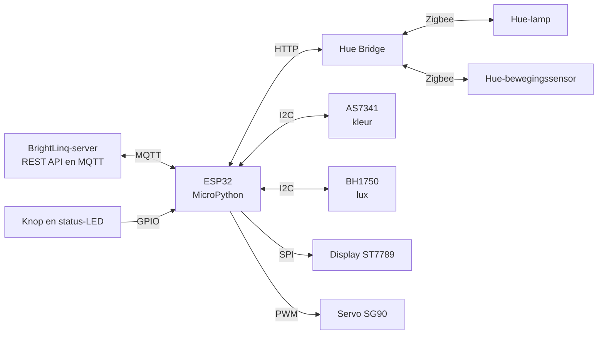

# Light-Colour-Led-Testbench

Project Embedded (PXL en Brightest), eerste evaluatie.

## Inhoud

1. [Over het project](#1-over-het-project)
2. [Schema](#2-schema)
3. [Documentatie](#3-documentatie)
4. [Bewijs van uitgevoerd werk](#4-bewijs-van-uitgevoerd-werk)
5. [Bijdrage per groepslid](#5-bijdrage-per-groepslid)
6. [Stand van zaken en volgende stappen](#6-stand-van-zaken-en-volgende-stappen)
7. [Mapstructuur](#7-mapstructuur)

---

## 1. Over het project

Een ESP32-testbank (MicroPython) die een Philips Hue-lamp test op kleur (AS7341) en lichtsterkte (BH1750), en een Hue-bewegingssensor test met een servo en een warm plaatje. De resultaten komen op een display en gaan via MQTT naar het Brightsense-systeem (BrightLinq).

| Onderdeel | Wat gebeurt er |
|---|---|
| Lamp-test | De lamp loopt door kleuren en wit-tinten in een donkere doos. De sensoren meten kleur en lux. |
| Bewegingstest | Een servo beweegt 10 keer een warm plaatje voor de Hue-sensor. De Hue Bridge meldt of de sensor reageerde. Score: X/10. |
| Rol binnen emBright | De ESP32 draait de Brightsense-client en meldt zich via MQTT aan bij de BrightLinq-server. |

## 2. Schema



## 3. Documentatie

| Bestand | Door | Inhoud |
|---|---|---|
| [Tutorial_Brightsense_Brightlinq.md](documentatie/Tutorial_Brightsense_Brightlinq.md) | Milan | Hoe het framework in elkaar zit: de BrightLinq-server met zijn REST API en de Brightsense-client op de ESP32, en welke bestanden wij moeten aanpassen. |
| [Communicatietest.md](documentatie/Communicatietest.md) | Runar | Onze eigen test met een nepsensor op de ESP32 en een laptop-server: stappenplan, volledige code en foutoplossing. |
| [BOM_Hue_RGB_lamptester9.xlsx](documentatie/BOM_Hue_RGB_lamptester9.xlsx) | Runar,Milan | Kostenanalyse: onderdelen, bestelreferenties, prijzen, verzending, alternatieven en compatibiliteit. |

De tutorial legt uit hoe server en client praten. De communicatietest toont dat onze ESP32 dat protocol ook echt spreekt.

## 4. Bewijs van uitgevoerd werk

| Soort | Waar | Stand |
|---|---|---|
| Schema | Hierboven, deel 2 | Klaar |
| Code | `test_device.py` (ESP32) en `laptop_server.py` (laptop) in [Communicatietest.md](documentatie/Communicatietest.md), delen 7 en 8 | Geschreven |
| Deeltest | [Communicatietest.md](documentatie/Communicatietest.md), deel 3 met de verwachte uitkomst | Resultaat: [invullen] |
| Berekeningen | [BOM](documentatie/BOM_Hue_RGB_lamptester9.xlsx), tabblad BOM: onderdelen € 58,31 + verzending € 21,41 = **€ 79,72** incl. btw | Klaar |
| Componentonderzoek | Zelfde Excel, tabbladen Compatibiliteit en Alternatieven | Op papier gecontroleerd |
| Framework en API | [Tutorial_Brightsense_Brightlinq.md](documentatie/Tutorial_Brightsense_Brightlinq.md) | Klaar |
| Kleur | [Kleurenspectrum](images/Kleurenspectrum-kelvin.png) en [template applicatienote](documentatie/AN_2627_PRE_KleurenspectrumLicht.docx) | Voorbereid |

## 5. Bijdrage per groepslid

| Naam | Bijdrage | Legt uit tijdens de toelichting |
|---|---|---|
| Runar | Kostenanalyse (BOM), communicatietest met code, README | Keuze van onderdelen en kosten, communicatietest |
| Milan | Uitleg BrightLinq en Brightsense, template applicatienote, kleurenspectrum | Framework en API, kleurmeting |

De volledige geschiedenis per persoon staat in de commits.

## 6. Stand van zaken en volgende stappen

Een afgewerkt prototype is er nog niet: we wachten op de bestelling.

| Stap | Status |
|---|---|
| Concept, onderdelenlijst en kostenanalyse | Klaar |
| Communicatietest met nepsensor | Geschreven, uitvoering volgt |
| Onderdelen bestellen | Volgende stap |
| Opstelling op breadboard bouwen en sensoren testen | Daarna |
| Code voor lamp-test en bewegingstest | Daarna |

## 7. Mapstructuur

```
README.md
documentatie/
    Tutorial_Brightsense_Brightlinq.md
    Communicatietest.md
    BOM_Hue_RGB_lamptester9.xlsx
    AN_2627_PRE_KleurenspectrumLicht.docx
images/
    Kleurenspectrum-kelvin.png
```
